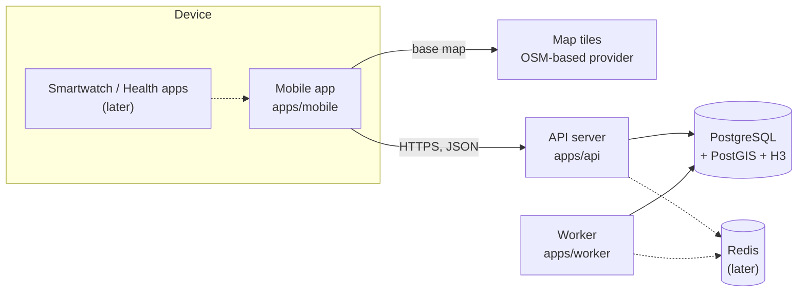

# Architecture

Status: **proposed**, except the language (TypeScript, accepted for now). Nothing here is built yet. Each big choice has its own record in [`decisions/`](decisions/), and any of them can be changed — see [how](decisions/README.md).

## The shape of the system

| Part | Folder | Job |
|---|---|---|
| Mobile app | `apps/mobile` | Records runs with GPS, draws the map and the hex overlay, shows territory, bases, routes. **Never decides game outcomes.** |
| API server | `apps/api` | The single source of truth. Validates uploaded runs, applies capture rules, stores everything, serves the map state for an area. |
| Worker | `apps/worker` | Things that happen without a request: moving resources along trade routes (~1 km/h), upgrade cooldowns, leaderboards. |
| Database | `apps/api/db` | PostgreSQL with PostGIS (geometry) and H3 (hex indexing). Migrations and seeds live next to the API that owns them. |
| Game rules | `packages/game-rules` | Pure functions, no I/O: capture rules, level math, trade-route shares. Used by the API for real and by the app for instant previews. |
| API contract | `packages/api-contract` | Request/response schemas shared by app and API, so both sides break at compile time instead of in production. |
| Infra | `infra` | Local dev setup (e.g. docker-compose for Postgres + PostGIS), later deployment config. |
| Translations | `locales` | All UI text, `en.json` is the source of truth (see AGENTS.md §3). |

## Rules that shape everything

1. **The server is authoritative.** A running game with territory and trading will attract GPS spoofing on day one. The app uploads raw GPS tracks; the API checks them (speed, jumps, mock-location flags) and only then awards hexes. The app may *preview* the result using `game-rules`, but the server's answer wins.
2. **Hexes are computed, not stored as a map.** We never store the planet as a hex grid (full OpenStreetMap is ~160 GB). A GPS point turns into a hex ID with H3 on the fly. The database only stores hexes that someone actually **owns**. See [ADR 0003](decisions/0003-hex-overlay-on-osm.md).
3. **The base map is someone else's problem.** Map tiles come from an OSM-based tile provider; we draw our hex overlay on top. Self-hosting tiles is a later cost decision.
4. **Feature folders mirror each other.** `territory` means the same thing in `apps/mobile`, `apps/api` and `docs/features`. Adding a feature = a folder in each place that needs it + a doc.

## How a run flows through the system

1. Player picks **Territory Run** or **Trade Route Run** and starts recording in the app.
2. The app records the GPS track locally (works offline) and shows a live preview.
3. On finish, the app uploads the track to the API.
4. The API validates the track, converts it to H3 hex IDs, and applies the rules from `game-rules` (capture hexes, count visits to strategic points, extend or strengthen a trade route).
5. Results are saved in one database transaction and returned to the app.
6. The worker later moves resources along trade routes and pays out shares.

## Where data lives

| Data | Where | Notes |
|---|---|---|
| Players, clans | Postgres | |
| Raw runs (GPS tracks) | Postgres (PostGIS `LineString`) | Kept for re-validation and anti-cheat; consider moving old tracks to object storage later. |
| Hex ownership | Postgres, keyed by H3 index | Only owned hexes are stored. |
| Strategic points | Postgres, PostGIS `Point` | Seeded by us from OSM landmarks, plus level and owner. |
| Bases | Postgres | One central point per player's territory. |
| Trade routes | Postgres | Route segments (per km), capacity, who ran each segment and how many times. |
| Resources in transit | Postgres | Position along a route + amount; the worker advances them. |
| Leaderboards, hot map areas | Redis (later) | Only when Postgres becomes the bottleneck. |
| Base map | External tile provider | Not in our database. |

## Not decided yet

- Hex size (H3 resolution). The board's favourite looks like street-level hexes — likely H3 resolution 11 or 12.
- Hosting (managed Postgres such as Supabase/Neon vs. own server).
- Whether there is a web app at all. If yes, it goes in `apps/web` and reuses `packages/`.
- Smartwatch import (Apple Health / Google Health Connect / Garmin / Strava).
